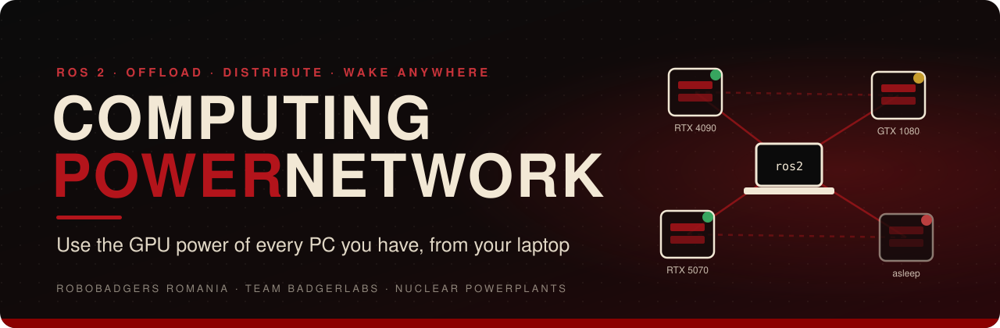
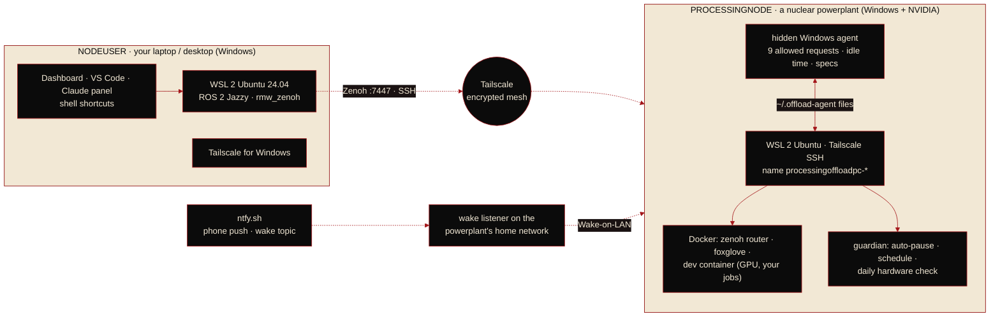
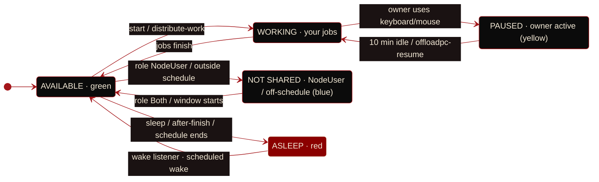

<p align="center">
  
</p>

<p align="center">
  
  
  
  
  
</p>

<p align="center">
  <b>Your laptop runs ROS 2. Your strongest PCs do the heavy work: AI, SLAM, simulation, training.<br>
  Pick them by their specs, split jobs between them, wake them from anywhere, and be fair to whoever owns them.</b>
</p>

<p align="center">
  <a href="#overview">Overview</a> ·
  <a href="#how-it-works">How it works</a> ·
  <a href="#getting-started">Getting started</a> ·
  <a href="#apps">Apps</a> ·
  <a href="#distributing-work">Distributing work</a> ·
  <a href="#fair-to-the-owner">Fair to the owner</a> ·
  <a href="#wake-over-the-internet">Wake</a> ·
  <a href="#roadmap">Roadmap</a>
</p>

<div align="center">
<table>
  <tr>
    <td align="center" width="25%"><h3>3 roles</h3><sub>NodeUser · Both · ProcessingNode</sub></td>
    <td align="center" width="25%"><h3>1 installer</h3><sub>restarts and resumes by itself</sub></td>
    <td align="center" width="25%"><h3>any network</h3><sub>wake, control and use from anywhere</sub></td>
    <td align="center" width="25%"><h3>≈ 6 s</h3><sub>hardware proof: GPU · VRAM · CPU · RAM</sub></td>
  </tr>
</table>
</div>


## Overview

> **The problem.** A laptop is where you write and run ROS 2, but it can't train a model, run a detector at full rate or simulate a big world. The PCs that can (yours at home, a relative's RTX 4090) sit somewhere else, and nobody wants to sit in front of them, keep them on all day or slow down their owner. How do you use their power from anywhere, as if it were in your laptop, without inconveniencing anyone?

**Computing Power Network** turns Windows PCs with NVIDIA GPUs into **nuclear powerplants**: they run ROS 2 Jazzy in the background (WSL 2 + Docker, GPU passthrough), invisibly for their owner, reachable over an encrypted **Tailscale** network from any internet connection. Your laptop is a **NodeUser**: its ROS 2 nodes and the powerplants' nodes form **one ROS graph** through **Zenoh** routers, so a camera node on the laptop and a YOLO node on the 4090 just talk. You choose the powerplant by its **specs** with a live dot (or let the **scheduler split your jobs** over several by their hardware), start them, put them to sleep after your work finishes, and **wake them from any network**.

> [!NOTE]
> **Project status.** Everything below is implemented and in this repository. Tested on real hardware so far: the Windows agent, power control, the busy verdict, the hardware check (GTX 1080 verified in 6 s, also inside the GPU container), the wake listener over ntfy.sh, the scheduler, the dashboard and the VS Code extension. The guardian's auto-pause, Wake-on-LAN through a listener and the uninstaller still need a field test on a second home network.

### Objectives

| | Objective | How |
|:-:|---|---|
| **O1** | **Use remote GPUs like local ones** | one ROS 2 graph over Zenoh; jobs run in a GPU Docker container on the powerplant |
| **O2** | **Pick by hardware** | every powerplant reports GPU · CPU · RAM, load and a live reachability dot; the scheduler places jobs by GPU tier × free VRAM and free CPU threads |
| **O3** | **Zero friction** | one installer, restarts and resumes by itself; dashboard, VS Code extension, Claude panel and shell shortcuts |
| **O4** | **Fair to the owner** | privacy mode, invisible agent, auto-pause while they use the PC, availability schedule, busy checks, full uninstall |
| **O5** | **Power aware** | sleep now / at a time / after work finishes; wake from any network; once-a-day hardware proof |

### Why Computing Power Network

| Approach | Your own hardware | Works from anywhere | Owner-friendly | ROS 2 graph across PCs | Cost |
|---|---|---|---|---|---|
| Cloud GPU (RunPod, Vast.ai) | no | yes | n/a | manual | ≈ $0.35–0.90 / h |
| Remote desktop (Parsec, Moonlight) | yes | yes | no (takes the screen) | no | free |
| Manual SSH + `ROS_DOMAIN_ID` | yes | LAN only (DDS multicast) | no | LAN only | free |
| Volunteer computing (BOINC) | yes | yes | yes | no | free |
| **Computing Power Network** | **yes** | **yes (Tailscale + Zenoh)** | **yes (guardian, schedule, privacy)** | **yes** | **free** |


## How it works



### A session

1. **Pick a powerplant.** The dashboard, the VS Code status bar or `list-powerplants` show every PC: `🟢 RTX 4090 · i9-13900K · 128 GB DDR5 6000MHz`. 🟡 means its owner is using it, 🔵 not shared right now, 🔴 asleep or off.
2. **Start it.** `start-nuclear-powerplant` wakes it if needed (from any network), starts its ROS containers, warns if the owner is around, and opens a shell **on it**.
3. **Work.** Gazebo and RViz run on your laptop; detectors, SLAM and training run on the powerplant; topics flow both ways through Zenoh. Several PCs at once: `distribute-work` splits `jobs.yaml` by hardware.
4. **Owner sits down?** The **guardian** pauses your container within ~10 s (`docker pause`, nothing lost), notifies you (VS Code + phone), and resumes after 10 min of no keyboard/mouse.
5. **Done.** `show-running-processes` says **IDLE** or **BUSY**; `sleep-nuclear-powerplant --after-finish` sleeps it the moment your work ends, optionally waking it again at a set time.

> [!IMPORTANT]
> **Privacy mode** (setup asks "whose PC is this?"): on someone else's PC, Ubuntu has **no access to the Windows drives and cannot run Windows programs**. The only bridge is a hidden agent that accepts exactly nine requests: `ping`, `sleep`, `sleep-until`, `wake-at`, `wake-weekly`, `clear-wake-weekly`, `off`, `restart`, `cancel`. Anything else is refused.

### A powerplant's states



### Roles

| Role | Uses the network | Shares this PC | Typical PC |
|---|:-:|:-:|---|
| **NodeUser** | ✓ | | laptop |
| **Both** | ✓ | ✓ | your desktop |
| **ProcessingNode** | | ✓ | a relative's RTX 4090 |

The installer installs everything on every PC; the role is a **switch in the app** (My PC tab), changed any time without reinstalling.


## Getting started

### Requirements

| | NodeUser (laptop) | ProcessingNode (powerplant) |
|---|---|---|
| OS | Windows 10 22H2 / Windows 11 | Windows 10 22H2 / Windows 11 |
| GPU | anything that runs Gazebo/RViz | NVIDIA (RTX recommended), current driver |
| RAM | 16 GB+ | 16 GB+ (more = bigger jobs) |
| Disk | ~30 GB free | ~60 GB free |
| BIOS | virtualization (VT-x / SVM) on | virtualization on; Wake-on-LAN on (optional) |

Plus a free **Tailscale** account (tailscale.com, sign in with Google/GitHub/Microsoft). **Closed circuit:** only PCs signed in to *your* account can see and use each other.

**Which drive?** Setup installs on the drive the kit is on. Kit on `D:\` or `X:\` →
Ubuntu (`X:\WSL\Ubuntu-24.04`), its swap file, Windows Tailscale (`X:\Programs\Tailscale`) and
the settings folder (`X:\OffloadPC`) all go there, keeping C: free. Kit on C: → the usual Windows places.

### Install

1. **Installer:** run `ComputingPowerNetwork-Setup-<version>.exe` (build it with [`installer/build-installer.bat`](installer/build-installer.bat)), pick the folder (its drive is where everything goes), keep **"Set up this PC now"** ticked.
   *Without the installer:* download this repo (**Code → Download ZIP**) and double-click **`SETUP-everything.cmd`**.
2. Follow the console window. When Windows needs a **restart it asks**, restarts, and **continues by itself** after you log in.
3. Ubuntu asks once for a **username + password** (type `exit` at the prompt afterwards); installs ask for that password.
4. **Powerplant questions:** a **name** (Enter = `processingoffloadpc`, or e.g. `4090` → `processingoffloadpc-4090`) and **whose PC is this** (`1` someone else's: privacy + guardian, `2` mine).
5. Sign in to **Tailscale** with the same account everywhere (the link the powerplant prints; the tray icon on your PCs). Check **login.tailscale.com/admin/machines**.
6. Open **Computing Power Network** from the Start menu → **My PC** → choose the **role**.

<details>
<summary><b>Per-role setup files and doing it by hand</b></summary>

<br>

| File | Installs |
|---|---|
| `SETUP-everything.cmd` | both roles (what the installer runs) |
| `SETUP-my-PC.cmd` | only NodeUser parts |
| `SETUP-processingoffloadPC.cmd` | only ProcessingNode parts |

By hand: `wsl --install -d Ubuntu-24.04` (admin) → reboot → create the Ubuntu user. Powerplant:
`processingoffloadPC\windows-setup.ps1 -WslUser <user>` (admin), then in Ubuntu
`POWERPLANT_NAME=processingoffloadpc PRIVACY=1 bash ~/ros2-remote/processingoffloadPC/setup-wsl.sh` and
`cd ~/ros2-remote/docker && sudo docker compose up -d --build`. NodeUser: `your-pc\windows-setup.ps1` (admin), then
`bash ~/ros2-remote/your-pc/setup-ros-client.sh`.
</details>

### Where do I type commands?

In an **Ubuntu terminal on your PC**, not PowerShell: Start menu → **Ubuntu 24.04** (prompt `name@PC:~$`), Windows Terminal → **˅** → **Ubuntu-24.04**, or in VS Code **BadgerLabs: Open ROS shell on this PC**. Inside `offloadpc` the prompt becomes `root@...:/ws#`: that terminal runs **on the powerplant** (`exit` comes back).

### Test it

```bash
list-powerplants                       # 🟢/🔴 + specs of every powerplant
use-powerplant 4090                    # pick one (or a full name, or "local")
start-nuclear-powerplant               # starts ROS there, opens a shell in its ROS container
ros2 run demo_nodes_cpp talker         #   publishes /chatter ON the powerplant
```
```bash
ros2 run demo_nodes_cpp listener       # second Ubuntu window, on YOUR PC: "I heard: [Hello World: N]"
```


## Apps

### Dashboard (pygame, self-updating)

<table>
  <tr>
    <td width="50%"><b>Network tab</b><br><sub>a card per powerplant: live dot, specs, GPU / VRAM / CPU / RAM bars, owner activity, jobs, hardware verification · actions: Start, Status, Running processes, Sleep, Sleep after finish, Sleep & wake at, Wake (any network), Resume, Restart ROS, Shut down · tick 2–3 PCs → <b>Distribute work</b> · <b>Update kit</b> updates this PC, every online powerplant, the VS Code extension and the Claude skill</sub></td>
    <td width="50%"><b>My PC tab</b><br><sub>this PC's hardware + <b>VERIFIED</b> badge · <b>role switch</b> NodeUser / Both / ProcessingNode · <b>network</b> closed circuit (global planned) · <b>availability schedule</b> (Always, Nights + weekends, Weekends only, Custom) · <b>system checker</b> with "Run hardware check now"</sub></td>
  </tr>
</table>

Build once with [`dashboard/build.bat`](dashboard/build.bat) → `ComputingPowerNetwork.exe`. You compile **`launcher.py`**: on every start it checks `dashboard/manifest.json` on GitHub, downloads a newer `app.py`, **refuses it if it doesn't compile**, falls back to the last good version (or the compiled-in one, also when GitHub is down). Recompile only when a version needs a new Python package.

> [!CAUTION]
> Auto-update runs whatever is on `main`: only people you trust should be able to push to this repository.

### VS Code extension: `BadgerLabsOffloadingPP` (Computing Power Network)

Status bar `🟢 RTX 4090 · 12%` / `🟡 · paused` / `🔴` → click for the menu: **Choose nuclear powerplant** (like picking an AI model: each PC by its specs with a live dot), Start, Show running processes, Sleep (now / at / after finish), Wake, Resume, Guardian, Phone notifications, **Distribute work** (multi-select), Distributed jobs status, Stop work, Open powerplant workspace (Remote-SSH), ROS shells, colcon build, Foxglove, Restart / Shut down, **Check for update** (it also checks GitHub every 6 h). Installed by the setup; by hand: `code --install-extension vscode-extension\BadgerLabsOffloadingPP-0.3.1.vsix`.

Two VS Code windows is the ROS workflow: **WSL: Connect to WSL** for your PC (Gazebo, RViz, light nodes) and **Open powerplant workspace** for the powerplant (attach to `docker-dev-1` with Dev Containers to work inside the GPU container). Recommended extensions (installed by setup): WSL, Remote - SSH, Dev Containers, Robot Developer Extensions for ROS 2, Python, C/C++, CMake Tools.

### Claude: skill + side panel

- **Skill** `computing-power-network` (installed by setup into `~/.claude/skills`): Claude Code knows the architecture, every command and the troubleshooting map, and follows the owner etiquette.
- **Side panel** next to the chat ([`claude-skill/cpn-panel`](claude-skill/cpn-panel)): powerplants with live dots and specs, quick actions (Status, Processes, Start, Sleep / anyway, Sleep after finish, Wake, Resume, Refresh); `/cpn` reopens it.

```
/plugin install computing-power-network --marketplace RoboBadgersRomania/PowerCluster
```
<sub>Desktop app: + next to the prompt → Plugins → Add marketplace `RoboBadgersRomania/PowerCluster` → add the plugin.</sub>

### Shell shortcuts (Ubuntu on your PC)

| Command | What it does |
|---|---|
| `list-powerplants` / `use-powerplant NAME` | all powerplants with dot + specs / switch (`local` = this PC only) |
| `start-nuclear-powerplant` | wake if needed, start ROS, open a shell on it; warns if the owner is around |
| `offloadpc` | shell inside the powerplant's ROS container |
| `show-running-processes` | GPU, CPU, owner, ROS nodes, tmux jobs → **VERDICT: IDLE / BUSY** |
| `sleep-nuclear-powerplant [HH:MM] [--after-finish] [--force]` | sleep now / and wake at HH:MM / when your work is done (`sleep-after-finish status\|cancel`) |
| `wake-nuclear-powerplant` | wake through its wake listener (internet) + this network + optional Tailscale relay |
| `offloadpc-resume` · `offloadpc-guardian [on\|off]` · `offloadpc-notifications [test]` | guardian controls, phone push setup |
| `distribute-work` · `cluster-status` · `stop-work` · `job-log NAME` | spread jobs over several PCs |
| `offloadpc-status` · `offloadpc-off` · `offloadpc-restart` · `offloadpc-cancel` · `offloadpc-mac` · `offloadpc-wake-info` | details, power, Wake-on-LAN info |


## Distributing work

Write your jobs once in `ws/jobs.yaml` (start from [`ws/jobs.example.yaml`](ws/jobs.example.yaml)):

```yaml
jobs:
  - { name: training, run: python3 /ws/src/my_pkg/train.py, gpu: true, vram_gb: 10, weight: 5 }
  - { name: yolo,     run: ros2 launch my_perception yolo.launch.py, gpu: true, vram_gb: 6, weight: 3 }
  - { name: slam,     run: ros2 launch slam_toolbox online_async_launch.py, cpu: 4, ram_gb: 4 }
  - { name: planner,  run: ros2 run nav2_planner planner_server, pin: desktop }
```

`distribute-work --on 4090,desktop` (or tick PCs in the dashboard / multi-select in VS Code) asks every PC for its hardware and load, shows the plan, and on **yes** syncs your code, builds it on each PC, links their Zenoh routers into one ROS graph and starts each job in its own `tmux` session.

| Job type | Goes to the PC with the lowest… | Considers |
|---|---|---|
| GPU (`gpu: true`) | (GPU load + weight) ÷ GPU power | GPU tier table (RTX 4090 = 100, GTX 1080 = 20…), free VRAM, current GPU use |
| CPU | (CPU work + cpu × weight) ÷ free threads | threads, 1-min load, free RAM |
| any | — | PCs whose **owner is active count ×0.3**; NodeUser / off-schedule PCs are skipped; `pin:` forces a PC |

> [!NOTE]
> It distributes **separate jobs** (nodes, launch files, scripts). One single program is not split across PCs; that needs the program itself to support it (e.g. PyTorch DDP), and home internet is slow for that.


## Fair to the owner

| | |
|---|---|
| **Invisible** | hidden agent (`conhost --headless`), Docker and Tailscale inside Ubuntu: no windows, no tray icons |
| **Privacy mode** | no Windows drives, no Windows programs from Ubuntu; 9 fixed agent requests |
| **Guardian** | owner touches keyboard/mouse → your container pauses within ~10 s → resumes after 10 min idle → you're notified both times (VS Code 🟡 + phone via [ntfy](https://ntfy.sh)) |
| **Busy check** | sleep / shut down / restart refuse while the owner was active in the last 10 min, GPU > 10 %, ROS nodes or running tmux jobs (`--force` to insist) |
| **Availability schedule** | e.g. `Mon-Fri 22:00-08:00; Sat-Sun 00:00-24:00`: outside it the PC isn't offered, sleeps after 30 min without anyone using it, and **wakes itself** at the next window |
| **Hardware proof** | once a day while nobody uses the PC (~6 s): the CUDA driver must name the same GPU, ≥ 80 % of the free VRAM must really allocate, all CPU threads must scale, RAM must write → **VERIFIED** badge everywhere |
| **Uninstall** | `UNINSTALL-processingoffloadPC.cmd` / Settings → Apps: removes everything and restores the original sleep timer, wake timers, Wake-on-LAN and `.wslconfig`; deleting Ubuntu / WSL is asked separately |

What the owner *will* notice: the setup (30–60 min, admin rights, 1–2 restarts), the PC not sleeping by itself during its availability window, and fans during heavy jobs. **Ask them first.** Keyboard/mouse is what the guardian sees; someone playing only with a gamepad isn't detected. The hardware proof catches wrong specs, missing VRAM and broken GPUs; it can't stop an owner with root access from cheating on purpose (that needs remote attestation).


## Wake over the internet

A sleeping PC is **not on the internet or Tailscale**, so the Wake-on-LAN packet must come from a device **on its home network**. The **wake listener** listens to the powerplant's private topic on [ntfy.sh](https://ntfy.sh) over HTTPS: no port forwarding, no account, no Tailscale on it. Press Wake anywhere → `wake <MAC>` → the listener wakes the PC.

| Runs the listener | Cost | How |
|---|---|---|
| **ESP32 board** | ≈ 30 RON | [`wake-listener/esp32_wake_listener`](wake-listener/esp32_wake_listener): Wi-Fi name, password, topic → Upload; plug into any USB charger |
| **Raspberry Pi / old laptop / NAS** | what you have | `python3 wake_listener.py --topic <topic>` (`sudo … --install-service` = start at boot) |
| **Old Android phone** | free | Termux: `pkg install python` → same command |
| **Scheduled wake** | free | `sleep-nuclear-powerplant 07:00` or an availability schedule |
| **Router app** | free if supported | many routers have a Wake-on-LAN button reachable from outside |

The topic and MAC: `offloadpc-wake-info`. Wake also broadcasts directly when you're on the same network. Enable *Wake on LAN / Power On By PCI-E* in the BIOS (ErP off), use **wired** Ethernet; waking from **sleep** works best.

> [!WARNING]
> **BIOS power-on password?** Waking from sleep never asks for it, but every **restart or shutdown** stops at the password screen and the PC stays unreachable until someone types it. On such a PC use only sleep. A setup/admin password doesn't matter.


## Repository layout

```
.
├── SETUP-everything.cmd · SETUP-my-PC.cmd · SETUP-processingoffloadPC.cmd    install (both / NodeUser / ProcessingNode)
├── UNINSTALL-my-PC.cmd · UNINSTALL-processingoffloadPC.cmd                   remove + restore original settings
├── setup.ps1 · uninstall.ps1 · common.ps1 · check-specs.ps1                   install logic (restart + resume), shared helpers
├── installer/        Inno Setup script + build-installer.bat → ComputingPowerNetwork-Setup.exe
├── dashboard/        pygame app: app.py (auto-updated), launcher.py (compiled), manifest.json, build.bat
├── processingoffloadPC/
│   ├── agent.ps1         hidden Windows agent (9 requests, idle time, MAC, specs)
│   ├── windows-setup.ps1 Windows side: WSL memory, agent task, power + Wake-on-LAN (originals saved)
│   ├── setup-wsl.sh      Ubuntu side: privacy mode, Docker, NVIDIA toolkit, Tailscale, guardian
│   ├── power.sh · lib.sh status, power, busy verdict, role, schedule, capacity, jobs, Zenoh links
│   ├── guardian.sh       auto-pause, schedule sleep, daily hardware check
│   └── hwcheck.py        hardware proof (CUDA driver API, CPU scaling, RAM)
├── your-pc/          NodeUser: Windows settings + Tailscale, ROS 2 + Zenoh + shortcuts, wol.ps1
├── cluster/          distribute.py: hardware-aware job scheduler
├── docker/           ROS 2 Jazzy image (Gazebo, Zenoh, Foxglove, tmux) + compose
├── wake-listener/    wake_listener.py + ESP32 sketch
├── vscode-extension/ BadgerLabsOffloadingPP source + .vsix + build-vsix.py (no Node needed)
├── claude-skill/     computing-power-network skill + cpn-panel side-panel plugin
└── ws/               your ROS 2 workspace (/ws in the container) + jobs.example.yaml
```

<details>
<summary><b>Troubleshooting</b></summary>

<br>

| Symptom | Fix |
|---|---|
| `tailnet policy does not permit you to SSH as user X` | X doesn't exist on that powerplant: use its **Ubuntu** username (`OFFLOAD_USER` in `~/.bashrc`, VS Code `badgerlabs.remoteUser`) |
| SSH hangs from Windows | Git's `ssh` is first in PATH: the apps use `C:\Windows\System32\OpenSSH\ssh.exe -n` |
| 🔴 although it's on | same Tailscale account? someone **logged in to Windows** (locked is fine)? |
| "Windows agent isn't running" | log out/in on the powerplant, or rerun its setup |
| `capacity` / `role` unknown | old scripts on the powerplant: dashboard **Update kit**, or rerun setup |
| `nvidia-smi` fails | update the NVIDIA driver **on Windows**, never inside Ubuntu |
| Working offline | `use-powerplant local`, then `ros2 run rmw_zenoh_cpp rmw_zenohd` |
| RAM slower than rated (e.g. 2400 instead of 3333 MHz) | XMP / DOCP is off in that PC's BIOS |
| Isaac Sim | CUDA/AI runs at full speed in Docker on WSL; for Isaac Sim use NVIDIA's container with livestreaming, or install it on Windows |
</details>


## Roadmap

**In this repository**

- [x] One installer for both roles, restart + resume, per-PC role switch in the app
- [x] Powerplants: privacy mode, hidden agent, guardian auto-pause + notifications, availability schedule, busy verdict
- [x] Power: sleep now / at a time / after work finishes, wake from any network (ntfy wake listener, ESP32 / Pi / phone)
- [x] Hardware-aware job distribution over several powerplants with one Zenoh-linked ROS graph
- [x] Daily hardware proof (GPU · VRAM · CPU · RAM) with a VERIFIED badge
- [x] Self-updating pygame dashboard, self-updating VS Code extension, Claude skill + side panel

**Next**

- [ ] Field test of the guardian, the wake listener and the uninstaller on a second home network
- [ ] Live migration of a paused job to another powerplant instead of waiting
- [ ] GPU-aware placement inside a PC with several GPUs

**Ideas**

- [ ] **Global network:** like a torrent swarm for compute: share idle GPU time with anyone, **earn credits** while your PC computes for others and **spend them** when you use the network (BOINC/Golem-style), next to today's closed circuit
- [ ] Spot-check jobs with known answers and remote attestation, so strangers' hardware can be trusted in the global network


## Team

<div align="center">

**Team BadgerLabs** · RoboBadgers Romania

<table>
  <tr>
    <td align="center"><b>Matei Sebastian-Alexandru</b><br><sub>Author</sub></td>
  </tr>
</table>

</div>

<details>
<summary><b>References</b></summary>

<br>

1. Open Robotics, [ROS 2 Jazzy Jalisco documentation](https://docs.ros.org/en/jazzy/)
2. ROS 2 / Eclipse Zenoh, [rmw_zenoh: a ROS 2 RMW based on Zenoh](https://github.com/ros2/rmw_zenoh)
3. Tailscale, [Tailscale SSH](https://tailscale.com/kb/1193/tailscale-ssh)
4. Microsoft, [Windows Subsystem for Linux: advanced settings (.wslconfig, wsl.conf)](https://learn.microsoft.com/windows/wsl/wsl-config)
5. NVIDIA, [CUDA on WSL User Guide](https://docs.nvidia.com/cuda/wsl-user-guide/)
6. NVIDIA, [Container Toolkit](https://docs.nvidia.com/datacenter/cloud-native/container-toolkit/)
7. NVIDIA, [CUDA Driver API](https://docs.nvidia.com/cuda/cuda-driver-api/)
8. ntfy, [Publish / subscribe over HTTP](https://docs.ntfy.sh/)
9. Foxglove, [Foxglove bridge](https://github.com/foxglove/ros-foxglove-bridge)
10. Ranch Hand Robotics, [Robot Developer Extensions for ROS 2](https://marketplace.visualstudio.com/items?itemName=Ranch-Hand-Robotics.rde-ros-2)
11. PyInstaller, [documentation](https://pyinstaller.org/) · pygame, [documentation](https://www.pygame.org/docs/)
12. JR Software, [Inno Setup](https://jrsoftware.org/isinfo.php)
13. D. P. Anderson, "BOINC: A Platform for Volunteer Computing", *Journal of Grid Computing*, 2020
</details>
